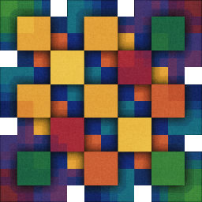
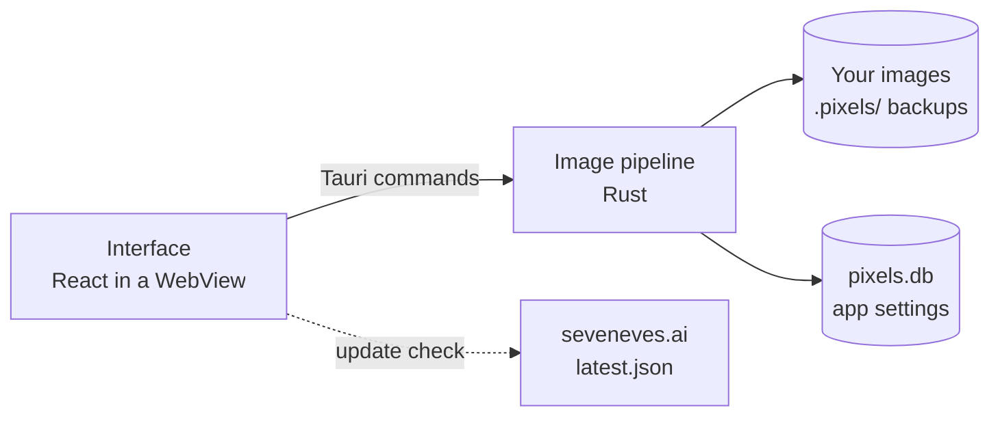

<div align="center">



# Pixels Toolkit

**Turn AI-upscaled pixel art back into clean, native-resolution sprites.**

A desktop app that finds the hidden pixel grid in an upscaled image and samples it down to size.<br>
Then it removes the background, merges near-duplicate colors and draws outlines, for one image or
a whole folder.

[](https://github.com/sevenevesai/pixels/releases/latest)
[](https://github.com/sevenevesai/pixels/actions/workflows/build.yml)


[**Download**](https://github.com/sevenevesai/pixels/releases/latest) ·
[Website](https://seveneves.ai/pixels/) ·
[For AI agents](#for-ai-agents) ·
[Report a bug](https://github.com/sevenevesai/pixels/issues/new)

</div>

---

AI image generators and upscalers draw pixel art at high resolution. Each art pixel becomes a
soft block of 4×4, 8×8 or more screen pixels, the grid may not start at the image corner, and the
sprite often sits on a flat magenta or green backdrop. An ordinary resize blurs those blocks
together and bleeds the backdrop into the sprite's edges.

Pixels Toolkit measures the block size and offset, samples one color per block, and hands you the
sprite at its native size, adjustable a pixel at a time. It works like an image editor on files
you already have: it opens, cleans and saves them. It does not generate or upscale art.

## Features

### Recover the native resolution

- **Grid detection.** Finds the block size (3 to 20 screen pixels per art pixel) and the grid's
  offset from edge-consistency and frequency analysis, then samples each block at that offset.
- **Pixel-level size control.** Width and height step by 1 px when detection is off by one, with
  a reset back to the detected size.
- **Auto-trim.** Crops transparent borders before detection. On by default.
- **Background removal.** Detects a solid backdrop from the image edges, flood-fills it to
  transparent and clears enclosed pockets of the same color. Tolerance runs from 10 to 60
  (default 30). It runs before downscaling so the backdrop cannot bleed into edge pixels.

### Finish the sprite

- **Color merge.** Merges colors that sit close together in LAB space (Delta E, default 3.0), so
  near-duplicate shades collapse into one.
- **Alpha cleanup.** Snaps semi-transparent pixels to fully transparent or fully opaque (cutoff
  200 of 255).
- **Outline.** Draws a 1 to 5 px outline in the color you pick, along the inside of the sprite's
  edge. The editor warns when the image already has one. The color is remembered across restarts
  and shared with bulk processing.
- **Zoomable preview.** Wheel zoom from 1× to 16×, drag to pan, a pixel-grid toggle, and
  double-click to reset the view.

### Work through a folder

- **Open anything.** Use **Open Image** or **Open Folder**, or drop one image or folder onto the
  window. Reads PNG, JPG, JPEG, BMP and WebP.
- **Include subfolders.** Browse and process a whole asset tree. `.pixels` folders and symbolic
  links are skipped.
- **Bulk Process.** Applies downscaling, background removal, alpha cleanup, color merge and
  outline to every image in scope, with a progress bar and **Cancel**. Downscaling detects each
  image separately and skips images that are not upscaled.
- **Backups and Revert All.** Before overwriting an image in a folder, the app copies the
  original into that folder's `.pixels/cache/`. **Revert All** restores every image the last bulk
  run changed.

## Install

Download the file for your platform from the
[latest release](https://github.com/sevenevesai/pixels/releases/latest) or the
[website](https://seveneves.ai/pixels/).

| Platform | File | First launch |
|---|---|---|
| Windows (x64) | `Pixels.Toolkit_<version>_x64-setup.exe` or `Pixels.Toolkit_<version>_x64_en-US.msi` | The installers are not code-signed. In the SmartScreen warning choose **More info → Run anyway**. |
| macOS (Apple Silicon and Intel) | `Pixels.Toolkit_<version>_universal.dmg`, or `_aarch64.dmg` / `_x64.dmg` for one chip | The app is not notarized. Open it once, then choose **Open Anyway** in **System Settings → Privacy & Security**. |
| Linux (x64) | `Pixels.Toolkit_<version>_amd64.AppImage` or `Pixels.Toolkit_<version>_amd64.deb` | AppImage: run `chmod +x` on it; it needs FUSE 2. Debian or Ubuntu: `sudo apt install ./Pixels.Toolkit_<version>_amd64.deb`. |

**Updates:** every install above updates itself. The app checks for a new version two seconds
after launch and shows a banner with **Update Now**. An update installs only if its signature
matches the key built into the app, and the app then restarts.

## Quick start

1. Click **Open Image** or **Open Folder**, or drop an image or folder onto the window.
2. In a folder, click a thumbnail. Tick **Include subfolders** to list nested folders too.
3. **Step 1: Downscale** shows the detected native size. Adjust the width or height if needed,
   tick **Remove background** for a solid backdrop, then click **Confirm & Continue →**.
   **Skip (Keep Original)** goes straight to post-processing.
4. Set **Color Merge** and **Outline**, then click **Save** to overwrite the file, or
   **Save As...** to write a new file.

> [!IMPORTANT]
> **Save** and **Bulk Process** overwrite your files. Only images opened from a folder get a
> backup in `.pixels/cache/`. An image opened with **Open Image**, or dropped on its own, is
> overwritten with no backup, so keep a copy or use **Save As...**.

## For AI agents

Pixels Toolkit is a GUI app. It has no command line, API or headless mode, so an agent cannot run
it on images from a script.

To work on the code, read [CLAUDE.md](CLAUDE.md). It covers the build commands, the processing
pipeline order, the Tauri command signatures, the default settings and the release process.
[tests/README.md](tests/README.md) explains what the browser suite covers and what it mocks.

## How it works



Previews, saves and bulk runs apply the steps in this order: background removal, trim and
downscale, alpha cleanup, color merge, outline.

- **Interface** [React 19, TypeScript, Vite]: `src/components/v2/WorkspaceV3.tsx` holds folders,
  drops, bulk processing and updates; `ImageEditor.tsx` holds the two editing steps and saving.
- **Image pipeline** [Rust, `image`, `rustfft`, `palette`]: `src-tauri/src/downscaler.rs` detects
  the grid and downsamples; `processor.rs` removes backgrounds, cleans alpha, merges colors and
  draws outlines.
- **Storage** [SQLite]: app settings such as the outline color live in `pixels.db` in the
  system's app-data folder. Each opened folder gets a `.pixels/` folder holding `cache/` backups,
  `thumbnails/` and `state.json`.
- **Shell** [Tauri 2]: the window, file dialogs, file access and the updater.

### What stays on your machine

- The only network request is the update check against
  `https://seveneves.ai/pixels/updates/latest.json`, and update downloads come from this repo's
  GitHub Releases. The app never uploads images.
- An update installs only when its signature verifies against the public key in
  `src-tauri/tauri.conf.json`.

## Known limitations

- **Revert All** covers only the most recent bulk run. Single-image saves have backups in
  `.pixels/cache/`, but there is no restore button for them yet. Backups are byte-for-byte copies
  named `<hash>_original.png`, whatever the original format.
- If the backup copy fails, the save still goes ahead.
- Grid detection covers blocks of 3 to 20 px. Outside that range, set the width and height by
  hand.
- There is no sprite-sheet export in the current interface. The packer in `packer.rs` is wired
  only to an older interface that the app no longer shows.
- One image or folder per drop.
- Windows and Linux builds are x64 only, and no build is code-signed or notarized.

## Build from source

Prerequisites: Node.js 20 with npm, Rust stable, and the
[Tauri 2 prerequisites](https://v2.tauri.app/start/prerequisites/) for your OS. On Debian or
Ubuntu, CI installs `libwebkit2gtk-4.1-dev libappindicator3-dev librsvg2-dev patchelf`.

```bash
git clone https://github.com/sevenevesai/pixels.git
cd pixels
npm ci
npm run tauri dev     # run the desktop app with hot reload
npm run build         # type-check and bundle the frontend only
```

`npx tauri build` writes installers to `src-tauri/target/release/bundle/`. Updater artifacts are
switched on, so without the release signing key in `TAURI_SIGNING_PRIVATE_KEY` it builds the
installers and then exits 1. For a local build, switch them off:

```bash
npx tauri build --config '{"bundle":{"createUpdaterArtifacts":false}}'
```

PowerShell 5.1 mangles the quotes in that JSON. Save `{"bundle":{"createUpdaterArtifacts":false}}`
to a file, then pass the file's full path: `npx tauri build --config C:\path\to\no-updater.json`.

Tests:

```bash
npx playwright install chromium                  # once
npm test                                         # 9 browser tests; CI runs them before releases
cargo test --manifest-path src-tauri/Cargo.toml  # 14 Rust unit tests
```

## Project structure

```
.github/workflows/   release build on version tags: browser tests, then installers per platform
src/                 React interface; App.tsx renders components/v2/WorkspaceV3.tsx
src-tauri/src/       Rust: Tauri commands (lib.rs), downscaler.rs, processor.rs, db.rs, state.rs
src-tauri/           tauri.conf.json (app, bundle and updater config), Cargo.toml, icons
tests/               Playwright suite with native file access mocked at the Tauri IPC boundary
CLAUDE.md            notes for AI coding agents
```

## Contributing

Report bugs and ideas in [Issues](https://github.com/sevenevesai/pixels/issues). CI runs only on
version tags, not on pull requests, so run the tests above and `npm run build` before sending one.
